<div align="center">

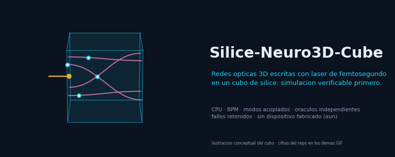

**Open research on three-dimensional linear optical transforms written with a femtosecond laser inside a fused-silica cube, and on the path from simulation to a first fabricated neural-network prototype.**


[Overview](#overview) · [Verified results](#verified-positive-numerical-results) · [FEMTO-1 prototype plan](#femto1) · [Scientific closure](#scientific-closure-20261013) · [Graphics lab](#lab-20261009) · [How it works](#how-it-works-in-8-gifs) · [Results](#results-to-date) · [Reproduce](#reproduce) · [Method](#method-and-collaboration) · [Roadmap](#roadmap)

</div>

---

## Overview

The idea is to write **waveguides, couplers and phase elements** inside a block of fused silica with a femtosecond laser, so that the geometry of the glass itself performs a linear optical transform of the light passing through it. The long-term goal is a neural network whose trained weights are compiled into fabricable geometry (gaps, lengths, depths) and "printed" into glass: **the model becomes the geometry**.

This repository does **not** present a finished processor. It links geometry and material properties to verifiable calculations, first in simulation and then, where the evidence allows, in a fabricable design. Every claim is tied to a preregistered protocol and hashed evidence, and failed tests are kept.

| Where the project stands (13 October 2026) | |
|---|---|
| Physics and scaling | Preregistered kill tests completed (T24–T30). See the [scientific closure](#scientific-closure-20261013). |
| Graphics-engine laboratory | Calibrated GPU rasterization of complex optical fields in Blender (OpenGL and Vulkan). See the [lab section](#lab-20261009). |
| Next milestone | **FEMTO-1**, a first passive glass chip that classifies light patterns, designed to be fabricated by femtosecond laser writing. See the [prototype plan](#femto1). |
| Fabricated or measured device | **None yet.** |

### Verified positive numerical results

The project has working numerical components and measured digital-simulation acceleration. These results remain approved within their stated scope; later negative experiments do not replace them.

| Positive result | Verified evidence | Scope |
|---|---|---|
| CUDA128 acceleration | CPU median **2.4528 s** versus resident CUDA128 median **0.10982 s**: **22.33× faster**, with three recorded hot repetitions | One scalar SSFM propagation case, not complete-network inference or an energy measurement. [Original timings and retained arrays](Docs/GLASS-GPU-2026-10-05-RESULTS.md) |
| CUDA numerical equivalence and local refinement | Four complex128 equivalence cases and eight further local cases pass their registered criteria | CPU/GPU wave-field parity and bounded stability; the four complex64 failures remain separate. [Results](Docs/GLASS-GPU-2026-10-05-RESULTS.md) |
| Graphics-engine complex fields | **168/168** P2 fields pass in OpenGL and Vulkan, including constructive, destructive and quarter-phase superposition; maximum error **5.86×10⁻⁷ ≤ 5×10⁻⁶** | Actual Blender rasterization and coherent field representation. [Independent audit and costs](Docs/POINT-03-RENDER-P3-ANALYTIC-RESULTS.md) |
| C2 / M2 temporal consistency | Both stages pass their five temporal criteria; M2's intensity indicator is **8.78×10⁻⁶ ≤ 10⁻⁵** | Audited discrete scalar solutions; spatial and domain closure remain separate. [M2 evidence](Docs/POINT-03-D16-M2-RESULTS.md) |

Potential device-energy and latency advantages are evaluated separately in the [FEMTO-1 plan](#femto1). They are conditional model predictions, including the positive fan-out scenarios, and have not yet been measured on a fabricated optical processor.

> **Historical context.** Microsoft's Project Silica ([official page](https://www.microsoft.com/en-us/research/project/project-silica/)) demonstrates volumetric **storage** in glass, not optical processing. It is neither a replica of this work nor evidence in its favour.

---

<a id="femto1"></a>
## FEMTO-1: plan for the first fabricated prototype

**Status: design plan, 13 October 2026. All numbers below are simulations, and the ones marked *exploratory* are not yet preregistered. No fabrication agreement is in place.** The target fabrication service is FEMTOprint (Switzerland), which publicly offers femtosecond-laser-written waveguides, directional couplers, fan-in/fan-out structures, multilayer routing and fiber-alignment features in fused silica.

### Why this demonstrator, and not a coherent mesh

The studies below identify constraints for a first coherent-mesh design. Their negative outcomes concern specified models and comparisons; they do not invalidate the project's approved CUDA, rasterization or temporal results:

- **T24:** for the registered 64×64 layer, 8-bit target and 1 GS/s electronic input/output, the cited converters and modulator cost 1.4–4.5× the selected 3 nm digital macro reference before optical-core costs. This parametric result is not a measurement or a verdict on every optical architecture.
- **T25:** for universal meshes built from two-mode elements under the dimension-count model, 3D connectivity saves at most one layer of logical depth. Structured transforms, routing and crossings are separate opportunities.
- **F3:** a 4×4 unitary mesh reached 59 % accuracy against an 85 % baseline.

Fixed phases would also need optical path control to about 30 nm, which laser-written glass cannot hold without heaters or trimming.

FEMTO-1 therefore uses a **passive, incoherent, phase-insensitive** design that plays to what femtosecond writing does well. It is built from directional couplers and crossing-free 3D routing.

### The device: a 3D fan-out that classifies

- **Input:** a 4×4 face, with 16 waveguides fed by a 2D fiber array. The pixel intensities x ≥ 0 are light.
- **Weighting:** each input feeds a tree of 3 directional couplers (48 in total). Splitting ratios are set by the interaction length L = (arcsin √r − θ_access)/κ(g).
- **Routing:** 48 useful branches are routed in 3D, **without a single crossing**, into 4 bundles, one per class. In a planar chip the same complete bipartite connection (K₁₆,₄) needs 720 crossings with inputs and outputs on opposite edges, and at least 112 in any planar drawing (Zarankiewicz number). In a volume it needs none.
- **Readout:** each bundle ends on one large-area photodetector, so crosstalk inside a bundle is irrelevant. The class is the brightest detector.

Two properties make this exact with respect to a digital linear classifier in the noise-free case:

1. argmax(Wx) is unchanged when the same row vector is added to every row of W. Signed weights can therefore be shifted to W ≥ 0 per column and rescaled to conserve power (Σₖ Wₖⱼ ≤ 1, remainder to a dump port). **Four detectors are enough, not eight.**
2. Rescaling does not change the decision; it only costs signal-to-noise ratio.

**The system is declared as "chip + 8 electronic parameters".** After the chip is measured, a gain and an offset per detector are calibrated on labelled bench data. This step compensates fabrication errors (see *Exploratory evidence*).

### Die content

| Zone | Content | Purpose |
|---|---|---|
| N1 | Trained classifier, 16 → 4 | Main demonstrator |
| N2 | N1 with pre-compensated coupler lengths | Process tolerance |
| N3 | Normalized class-prototype classifier | Interpretable control ("the glass remembers each digit") |
| N4 | Uniform 1 → 4 splitters | Bench calibration and process uniformity |
| K1 | Single couplers, gaps 14/16/20 µm, lengths scaled per gap, lateral and vertical pairs, two depths | Measure the real κ(g), its anisotropy and depth dependence |
| K2 | Straight guides, 1–4 cm | Propagation loss by cut-back |
| K3 | S-bends and arcs, R = 15–40 mm | Real bend envelope |
| T | Termination of the 16 dump ports away from the detectors | Discarded light (≈ 54 %, ≈ 3.4 dB) must not reach the outputs |
| F | 2D fiber hole array, output V-grooves, fiducials on both faces | Passive fiber alignment |

Minimum viable die: N1 + K1 + K2 + F. Preferred sequence: a coupon run (K1–K3) to calibrate κ, then the full die.

### Work plan, from data to a fabrication-ready package

| Phase | Work | Gate before moving on |
|---|---|---|
| **F0** Foundry rules *(owner, in parallel)* | Feasibility request. Ask the foundry for accepted design formats, 3D pitch and depth limits, real bend radius, relative coupler-gap precision, PDL, κ(λ), mode-field diameter, cost and lead time | Rules and format confirmed in writing |
| **F1** Data and preregistration | MNIST downsampled to 4×4 (7×7 block mean), classes 0–3. Sealed test split (≥ 2000 images, labels kept outside the repository, one-time reveal). Baselines: majority, logistic with and without bias, small MLP, prototypes. Protocol committed with `python -m agentkit.prereg commit … --query-server` **before** training | Commitment verified on the server; partitions sealed with SHA-256 |
| **F2** Hardware-aware training | Differentiable forward model: W ≥ 0, power conservation, shot and amplifier noise, leakage, correlated κ errors, 8-parameter readout calibration. Noise-injected fine-tuning with projection onto W ≥ 0 | Validation within 3 pp of digital logistic regression; ≤ 2 pp loss at σκ = 10 % with calibration |
| **F3** Compilation to 3D geometry | Weights → coupler tree (exact reconstruction, error 1e-16) → lengths with access-bend coupling subtracted, gap chosen per coupler (L ≥ 0) → crossing-free 3D lanes, R ≥ 25 mm. Path-length staggering inside each bundle beyond the source coherence length. Design-rule check: bends, spacing, depth, outline, no intersections, output-face fit, dump termination, angled facets | Clean design-rule check; W rebuilt from geometry within 1e-10 |
| **F4** Blender digital twin | Scene built from the geometry JSON (SI custom properties, SHA-256 export), so Blender objects become the source of truth. Exact round trip. The frozen network is evaluated **inside Blender** on the sealed test set, then compared with an independent CPU path (identical predictions, ≤ 1e-12). Renders through the shared GPU queue (presentation only) | Exact round trip; sealed benchmark recorded whatever the outcome |
| **F5** Independent physics | Beam-propagation or angular-spectrum solver with the foundry's index profile. Checks: a single coupler including S-bend coupling, a full 1 → 4 tree, a 1530–1570 nm sweep, both polarizations, single-mode regime (LP₁₁), lateral and vertical anisotropy, depth dependence, coherence averaging | Ratio discrepancy ≤ 2 % absolute, or a correction applied and F3–F4 rerun |
| **F6** Fabrication Monte Carlo and optical budget | 200 seeded realizations over gap (κ ∝ e^(−0.42 g/µm), i.e. +52 %/−34 % per µm), index contrast, leakage, loss, depth, polarization, fiber misalignment and input non-uniformity. Optical budget from source to photodiode and amplifier noise. Adversarial review | Mean accuracy ≥ target − 3 pp at the confirmed tolerance; source ≤ 10 mW; no open blocking objection |
| **F7** Fabrication package | See the next table | All re-imports agree; signed manifest |
| **F8** Freeze and approval | Independent full rerun from scratch, critical review of every claim, tag `femto1-fab-v1` (fast-forward only), owner's explicit approval to send | Checklist complete |
| **F9** After fabrication | Inspection; κ, loss and bend coupons first (model amendment registered before measuring N1); measured W; readout calibration; sealed test by fiber array or DMD; latency; energy model calibrated with measured power and SNR; raw data published, failures included | Preregistered criteria C1–C4 |

**Bench criteria (to be preregistered):**

- **C1:** measured W with RMS error ≤ 5 % and leakage ≤ 1 %, in both polarizations.
- **C2:** non-inferiority within 3 pp of digital logistic regression on ≥ 2000 sealed images (paired 95 % CI).
- **C3:** input-to-amplifier-output latency ≤ 2 ns at the budgeted optical power.
- **C4:** modelled energy ratio ≥ 3× against an equivalent digital readout of the same light.

### Fabrication package (F7)

FEMTOprint does not publish its design-file format. A FEMTO-ST facility that operates a FEMTOprint machine documents this flow: CAD (DXF, DWG, IGES, STEP, STL) is imported into ALPHACAM, which generates machine code (`.enc`). The package is therefore multi-format and will be confirmed in F0. The laser recipe (power, speed, passes) belongs to the foundry and is not prescribed.

| File | Content |
|---|---|
| `FEMTO1_geometry.json` + `.sha256` | **Source of truth:** every waveguide centreline, couplers, bundles, fiducials, material and wavelength (SI internally) |
| `FEMTO1_trajectories.csv` | `guide_id, segment_id, type, x_um, y_um, z_um`, sampled at ≤ 10 µm on bends |
| `FEMTO1.step` | Block, alignment features, fiducials and guides drawn as tubes. The tubes are a visual reference only: fs writing is a trace, and the centreline is the fabrication datum. |
| `FEMTO1_layers.dxf` | Per-depth projections and top view |
| `FEMTO1.stl` | Mesh for quick inspection |
| `FEMTO1_drawing.pdf` | Dimensioned drawing with tolerances and port numbering |
| `SPEC-FEMTO1.md`, `SIMULATION-REPORT.pdf` | Specification, coupler ratio table, zones, acceptance criteria, F2–F6 results |
| Render and video | Presentation (Blender, via the GPU queue) |

### Exploratory evidence (not preregistered; to be repeated under F1–F6)

| Check | Result |
|---|---|
| sklearn digits 4×4, classes 0–3 (216 test images, ±2.9 pp binomial CI) | Non-negative optical layer = logistic regression without bias, 94.9 % |
| MNIST 4×4, classes 0–3 (4157 test images, independent reviewer) | W ≥ 0 without bias 88.5 %; logistic with bias 90.4 %; normalized prototypes 79.3 % |
| Correlated coupling errors σκ = 5 / 10 / 20 / 40 % (digits) | Without calibration 88 / 77 / 63 / 44 %; with 8-parameter readout calibration **95 / 95 / 94 / 86 %** |
| Amplifier read noise at 5 % of pixel scale (digits) | Optical 85 % vs digital 93 %: noise is the main trade-off to measure |
| Global brightness × 0.5 (digits) | Unchanged without calibration offsets (argmax is scale-invariant) |
| One-pixel image shift (digits) | Collapses to 9 %, so alignment is handled by the bench and the fiber array |

**Critical risk.** Coupling decays exponentially with gap (≈ 0.42 per µm for the current model, which is provisional because it assumes a 12 µm step-index core while the foundry quotes a 6–8 µm mode-field diameter). If the foundry's *relative* gap precision is worse than about ±0.5 µm, the coupler design fails even with calibration. The fallback is MMIs or Y-junctions, or a coupon run with compensation. This is the first question for F0.

**Lessons adopted from the precursor [NeuroPixel](https://github.com/Agnuxo1/NeuroPixel):** an explicit prototype decoder as control (it beat dynamic memories there); scale invariance of the decision; sensitivity to small spatial shifts; few processing stages; and run logging with SHA-256 preregistration.

### Positioning against electronics

| Claim | Status |
|---|---|
| Fewer optoelectronic conversions when the input is already light | Defensible as a model: N → M reads (16 → 4 = 4×; 64 → 4 = 16×) |
| Latency set by photodetector and amplifier (glass ≈ 0.2 ns) | Defensible and measurable (C3) |
| Zero static power in the glass | True for the passive core; source, amplifiers and converters are counted |
| Energy versus a real GPU (64 × 64 layer, T24 model with a 3D fan-out at 0.35 dB per stage) | Optimistic 80 fJ/MAC, nominal 573 fJ/MAC, against ≈ 2.5 pJ/MAC (RTX 3090) and ≈ 0.7 pJ/MAC (H100). These are approximate board-level peak INT8 spec-sheet values, still to be verified. That is a **4–30× advantage over an RTX 3090 and 1.2–9× over an H100**, model only. The GPU figure includes memory and control; the optical model does not. |
| Energy versus the best experimental digital macro (3 nm INT8, 16 fJ/MAC) | **Not reached** (≈ 5× worse) because of converters; break-even near a 300-wide layer |
| Energy saving with electronic input/output in the registered 64×64, 8-bit, 1 GS/s case | **Not supported by T24 under its cited component assumptions**; other sizes, interfaces and architectures require their own comparisons. |
| Universal-mesh depth advantage from 3D | T25 bounds the possible saving to at most one layer within its two-mode-element model. Structured transforms, crossings and routing are separate comparisons; this is not a general rejection of 3D advantages. |

### Long-term vision: the model is the geometry

The vision is a trained network, ultimately a large language model, compiled into the volume of a glass cube. Light performs the fixed-weight multiplications; thin electronics on the faces does the rest. Rough design numbers:

| Parameters | Planar area at (10 µm)² per weight | Cube side at 3 × 3 × 10 µm³ per weight | Writing time (1 MHz, one beam) |
|---|---|---|---|
| 8 × 10⁹ | 0.8 m² | 0.9 cm | 2.2 h |
| 7 × 10¹⁰ | 7 m² | 1.9 cm | 19 h |
| 1 × 10¹² | 100 m² | 4.5 cm | 12 days (≈ 3.5 h with 8 beams at 10 MHz) |

- One cubic centimetre holds about 3 × 10¹¹ λ³ volumes at 1550 nm, and a 1 cm face at 10 µm pitch offers about 10⁶ I/O channels.
- In LLM inference, much of the energy goes into **reading weights from HBM for every token**: about 31 J per token at batch 1 for 10¹² 8-bit weights at 3.9 pJ/bit. In glass, the weights are geometry and that traffic disappears.
- **Attention.** Q·Kᵀ multiplies activations by activations. It can be done optically by photoelectric multiplication: interfere the q and k fields and use balanced detection, so the photodiode returns 4·Re Σ qᵢkᵢ*. The companion project [Neuro3D](https://github.com/Agnuxo1/Neuro3D) shows in simulation that detector powers are quadratic forms of the input fields, with rank ≤ 2 per detector. The glass only adds fields (E = Ux); the product arises at square-law detection.
- **What remains electronic:** the KV cache, softmax and detection.
- **Open problems:** inter-layer nonlinearity, 4–6 bits of analog precision per written weight, noise across ~100 layers, and the fact that every model version is a new cube.

**Milestones:**

1. FEMTO-1 (16 → 4)
2. A 256–1024-wide layer written volumetrically
3. A small complete network with electronic nonlinearity on the faces
4. A small transformer with fixed projections in glass and optical q·k (FEMTO-2 will carry the first q·k coupon)
5. Billions of parameters

---

<a id="scientific-closure-20261013"></a>
## Scientific closure · 13 October 2026

**Status: numerical study with preregistered kill tests. No device has been fabricated or measured.** Every statement below comes from the claims ledger [`Docs/CIERRE-20261012/CLAIMS-TABLE-20261013b.md`](Docs/CIERRE-20261012/CLAIMS-TABLE-20261013b.md), whose evidence files are hashed. Manuscript: [`paper/manuscript.pdf`](paper/manuscript.pdf).

**Central claim** (a delimitation, not a novelty claim; revised after an adversarial review). For femtosecond-laser-written waveguide meshes in glass with the component values found:

- **(a)** 3D connectivity can save **at most one layer** of a universal mesh of two-mode elements (bound N − 1 for even N and N for odd N; planar rectangular meshes need N).
- **(b)** At N = 64 and 8 bits, the **converters and modulators alone** cost about 72 fJ per multiply–accumulate, 1.4–4.5× a 3 nm INT8 digital macro, independently of the optical core. With the single published loss per fs-written interferometer stage, a dense passive layer needs 0.10 nJ per MAC.
- **(c)** **Crossings alone do not decide** a 3D advantage. At the only verified crossing loss (≤ 0.01 dB at 80°), the 11 worst-path crossings of a planar butterfly at N = 16 cost about 0.11 dB, less than one 3D S-bend (0.4–0.5 dB in the same source).

| Test (registered before running) | Result | Status |
|---|---|---|
| T25 · depth and crossings, 3D vs planar | Clements depth N, triangular 2N − 3; 3D saves at most one layer; planar butterfly Θ(N²) crossings | PASS (verification gates, 7/7) |
| T27 · in-situ calibration of splitter errors | 95/95 infidelity bound 1.5·10⁻² → 1.3·10⁻⁴ (N = 8, σ = 0.02 rad); not reached at σ = 0.05 rad | PASS (model, 3/3) |
| T24 · energy per MAC | Fails vs 3 nm INT8 even with a lossless optical core (converter floor); full SVD mesh 0.10 nJ/MAC | **FAIL → energy hypothesis withdrawn** for coherent meshes with electronic I/O |
| T26 · state of the art (31 verified records) | Lowest verified loss found at 1550 nm in fused silica: 0.06 ± 0.02 dB/cm. 3D fs Fourier circuits (2016) and a 3D photonic neural network in glass (2026) exist | PASS (review gates) |
| T30 · adversarial review | Independent recomputation; corrected the first wording of claims (a)–(c) | Internal AI review done; external human review pending |
| T20D · trench-width design | Ideal HE₁₁ leakage 0.044 dB/cm (t = 12 µm) → 0.0020 dB/cm (t = 16 µm) | PASS (model) |

**Measurements that would falsify the central claim:**

- The per-stage loss of a cascaded fs-written MZI mesh in silica: ≤ 0.13 dB would reverse the 2014 comparison.
- The loss of series crossings and of 3D transitions.

**Next test of the waveguide programme (registered, not run):** blind cut-back of HE₁₁ at 1550 nm on trench guides with t = 12 µm (feasibility, ≤ 0.3 dB/cm) and t = 16 µm (state of the art, ≤ 0.06 dB/cm). It needs a fabrication partner: see the [fabrication dossier](Docs/CIERRE-20261012/T28-FABRICATION-DOSSIER.md).

**How it was done.** Protocols, inputs and planned outputs were committed and verified on GitHub before computing ([`agentkit.prereg`](agentkit/prereg.py)). One crashed run was kept and repeated under a dated amendment, and two earlier novelty claims were withdrawn. The closure kit (`agentkit/`) is byte-identical to the [guide](Docs/GUIA-CIERRE-CIENTIFICO-v2-20261012.md) and passes 61 tests on Windows and Linux ([CI](.github/workflows/agentkit.yml)).

**Reproduce (CPU, one thread):**

```bash
python -m pip install --require-hashes -r requirements/agentkit-linux-py313.lock
python -B -m unittest agentkit.test_v1 agentkit.test_v2
python -B experimentos/t25_escalado_claude/run_t25.py --outdir <new folder>
```

**License:** [Apache License 2.0](LICENSE) for the whole repository (code, documents, figures and data; see [NOTICE](NOTICE)).

**Open decisions for the owner:** archive with DOI, and a fabrication partner.

**Reports:** [`Docs/CIERRE-20261012/`](Docs/CIERRE-20261012/). Spanish summary: [`RESUMEN-PARA-FRAN.md`](Docs/CIERRE-20261012/RESUMEN-PARA-FRAN.md).

---

<a id="lab-20261009"></a>
## Scientific laboratory · 9 October 2026

**The core of the project is our optical network inside a 3D engine.** Geometry, complex field, phase and detection must keep their physical meaning when graphics hardware is used. CPU references make that meaning checkable; the look of an image does not validate the physics.

| Current evidence | Result | Scope |
|---|---|---|
| D16 C2 / M2-R1 | Temporal audits passed; M2 keeps 83 fields and computes 13 new ones | Consistency of discrete solutions; [M2 audited](Docs/POINT-03-D16-M2-RESULTS.md) |
| F1, h = 0.35 µm | Colab (9 Oct): 96/192 fields, result lost. F1R2 (13 Oct, local CPU, registered): 192/192 fields, all five criteria met (field 1.35×10⁻⁵ ≤ 10⁻⁴) | Integrity and anchored audits passed; failed F1R retained. [F1R2 results](Docs/CIERRE-20261012/T01-F1R2-RESULTS.md) |
| R1 P2 in Blender/RTX 3090 | 84 frames kept; 63 fail precision | Faulty readout and insufficient timing; [negative retained](Docs/POINT-03-RENDER-GPU-RUN02-RESULTS.md) |
| P0, calibrated graphics readout | Six GPU marks audited, maximum error 6.68×10⁻⁸ | Coordinates/channels and clock/closure approved; [calibration](Docs/POINT-03-RENDER-BUFFER-RESULTS.md) |
| R2 corrected P2 | 84 new frames: integrity and timing approved; 63 fail precision | Maximum error 1.62×10⁻⁴ > 5×10⁻⁶; [audited negative](Docs/POINT-03-RENDER-P2-CORRECTED-RESULTS.md) |
| P1, OpenGL and Vulkan | 60 new marks; integrity approved, nine failures per backend | Analytic coordinates precise; smooth interpolation negative. [Results](Docs/POINT-03-RENDER-PIPELINE-RESULTS.md) |
| R3 analytic P2 | 168 new fields: 84/84 approved in OpenGL and 84/84 in Vulkan | Maximum error 5.86×10⁻⁷ ≤ 5×10⁻⁶; P2 representation and coherent sum. [Audited results](Docs/POINT-03-RENDER-P3-ANALYTIC-RESULTS.md) |
| CPU software | 51 tests passed in the previous release | No GPU initialization; [log](resultados/codex/point03_main_cpu_tests_20261009/report.json) |

T96/Q4 remains open. F1 is complete and audited (F1R2), but spatial convergence, prospective prediction, the reserved 0.28 µm mesh and the domain are still missing. Fabrication, measurements, a complete network and external reproduction remain pending.

### Temporal audit: data, thresholds and two detectors

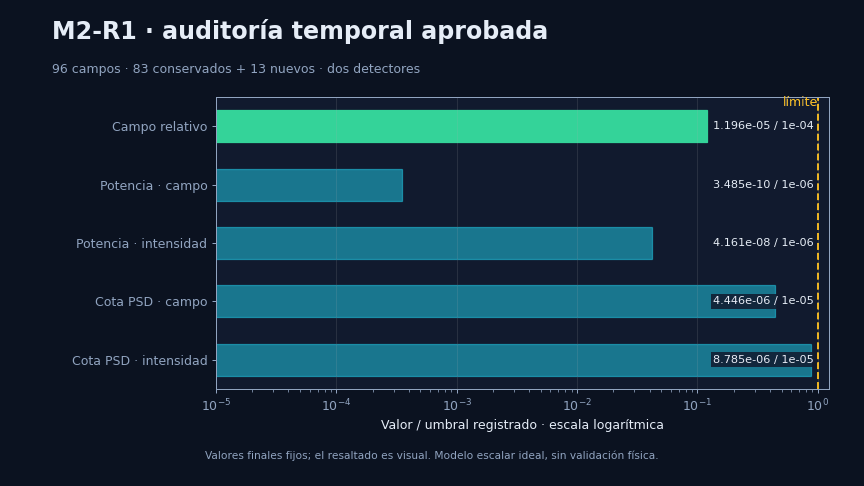

Each bar is a fixed final value divided by its threshold, on a logarithmic scale. The highlight moves to aid reading; **it does not represent temporal propagation or new data**. The PSD bound is the registered numerical indicator, not a guarantee on the continuous error.

### Graphics engine: calibrating the GPU readout too

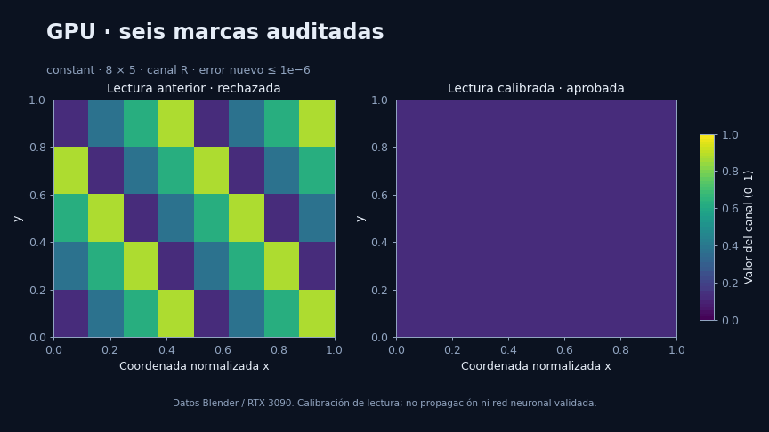

3D triangles, rasterization, shaders and an FP32 framebuffer were run in Blender 4.5.14/OpenGL on an RTX 3090. Independent calibration detected and corrected the buffer interpretation. The six new cases passed; the 84 earlier P2 results remain negative. A readout calibration **is not a validated neural network**. All timings, including start-up and readout, are kept. No general speed or energy advantage has been demonstrated.

### OpenGL and Vulkan: precision of graphics coordinates

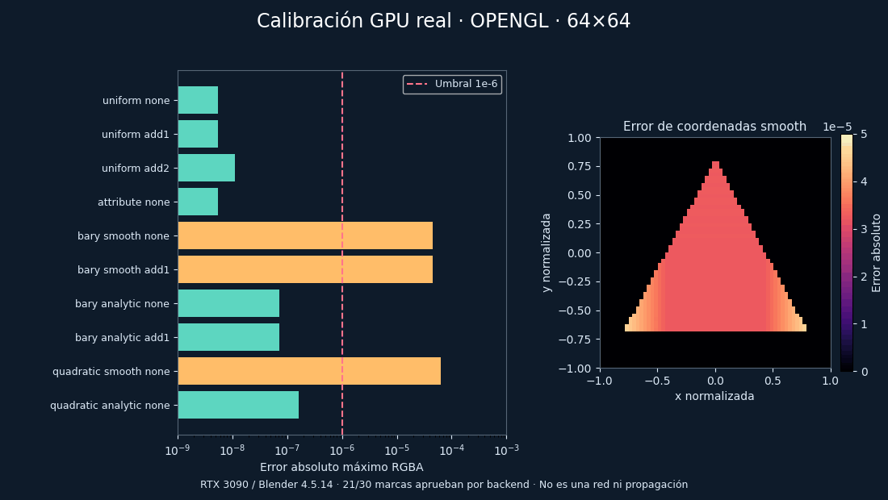

Each backend passes 21 marks and retains nine failures. Coordinates computed in the fragment shader pass; those interpolated by smooth shading fail. This is a real calibration of the graphics instrument, without a functional network or optical propagation.
[Data, costs and results](Docs/POINT-03-RENDER-PIPELINE-RESULTS.md) ·
[Generator](tools/gif_pipeline_calibration_20261009.py) ·
[Manifest](resultados/codex/point03_pipeline_gif_manifest_20261009.json).

### P2 complex fields: rasterization and superposition audited

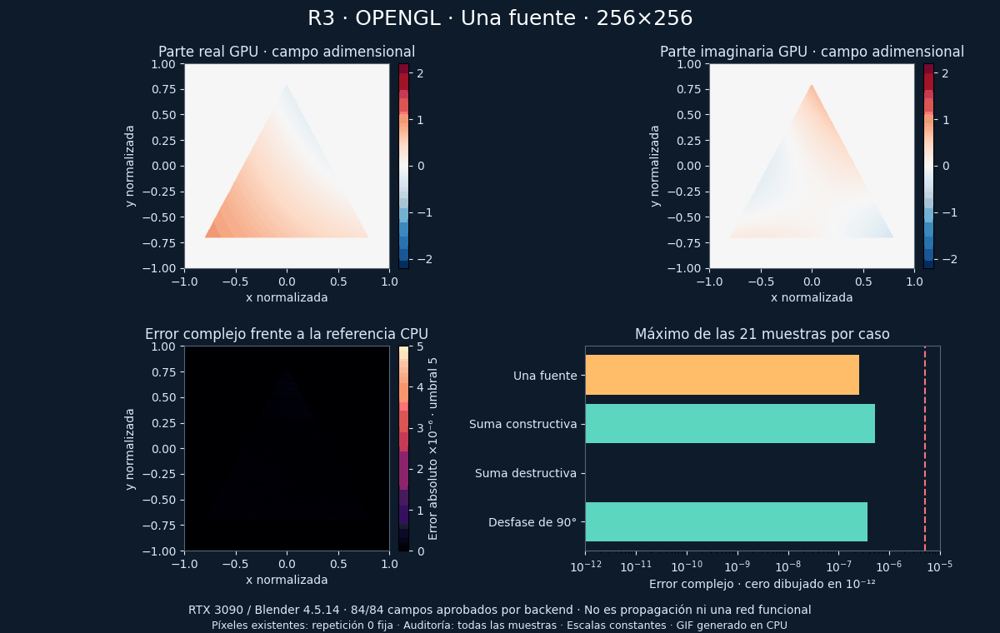

OpenGL and Vulkan pass all 84 fields of each trial, including constructive and destructive sums and a 90° phase shift. The 3D triangles are rasterized; the fragment shader computes the complex field, and the coherent sum preserves its phase. The GIF shows already-computed pixels, with a constant scale and a fixed zero repeat. The bars include the 21 samples of each case.

This is a manufactured P2 representation bench, without guided propagation or a functional network. All preparation, start-up, drawing and readout costs are published, and no general or energy advantage has been demonstrated.
[168 raw fields, audits and costs](Docs/POINT-03-RENDER-P3-ANALYTIC-RESULTS.md) ·
[Generator](tools/gif_p3_analytic_v2_20261009.py) ·
[Manifest](resultados/codex/point03_p3_gif_manifest_v2_20261009.json).

### Architecture of the network we want to test

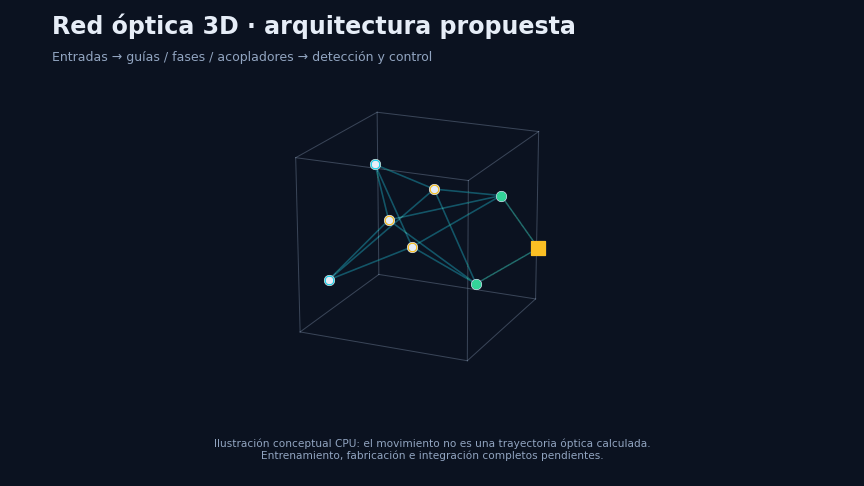

**Conceptual CPU illustration, labelled in every frame.** The dots show the proposed flow; they do not claim computed optical trajectories. The passive network is linear in field. Detection, nonlinearity and control must be declared and validated as part of the complete system. The [FEMTO-1 plan](#femto1) is the first concrete, fabricable instance of this architecture.

The animations are produced by [the reproducible generator](tools/gif_scientific_snapshot_20261009.py).
[Manifest of inputs, versions and hashes](resultados/codex/point03_readme_gif_manifest_v2_20261009.json).

<details>
<summary>Earlier versions of these four GIFs (before the visual review, kept for traceability)</summary>

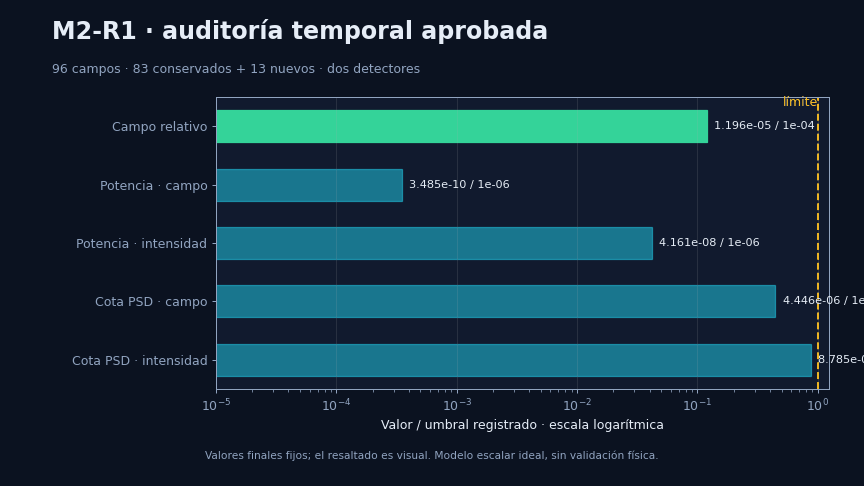


</details>

### Graphics acceleration: apply and verify before claiming advantages

We use native rasterization, geometric interpolation, complex-field shaders, prepared geometry and FP32 storage. Vulkan has already run in this calibration. Instancing, asynchronous transfer and BVH/RT will be evaluated where they match the subproblem, each with a prior protocol and a full precision and cost comparison. RT cores can accelerate intersections, but the coherent field and its propagation need a verified optical model of their own. [Technologies, evidence and next trial](Docs/GRAPHICS-ACCELERATION-20261009.md).

The eight historical GIFs below keep their original data and dates.

## How it works in 8 GIFs

Every GIF in this section is generated with `tools/` from the repository's data and experiments. Conceptual content is labelled as illustration.

### 1 · The laser draws the cladding; the core stays untouched

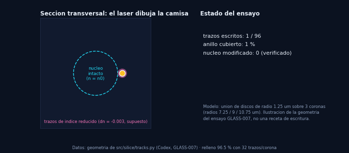

An unmodified silica core is surrounded by **reduced-index tracks** (depressed cladding). Here, three rings of 1.25 µm discs (GLASS-007 geometry). With 32 tracks per ring the annulus is 95 % filled; with 16, 69 %.

### 2 · Does the cladding hold the light?

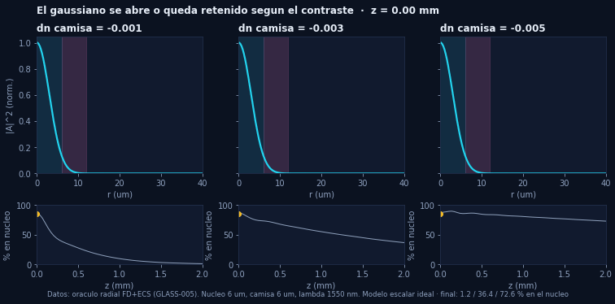

A beam propagates 2 mm. With weak contrast (δn = −0.001) it spreads; with δn = −0.005 it stays mostly in the core (1.2 % / 36.4 % / 72.6 %). Result of a radial solver independent of the BPM. **Ideal scalar model**, not a measured guide.

### 3 · Leakage falls exponentially with thickness

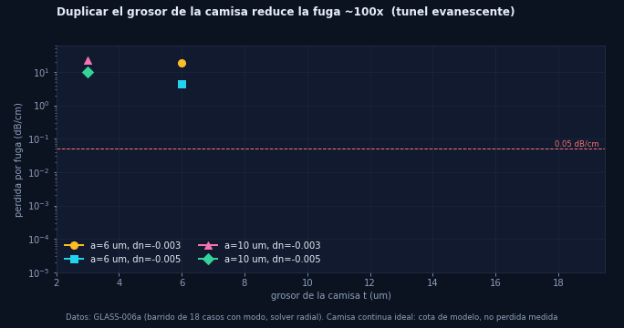

The mode is *quasi-bound*: it tunnels out through the cladding. Doubling the thickness reduces leakage about 100×, and the WKB prediction fixed before measuring holds (×107 predicted, ×101 observed). With a 6 µm core and δn = −0.005, about 12 µm of continuous cladding gives 0.044 dB/cm **in the model**.

### 4 · A coupler mesh computes a transform

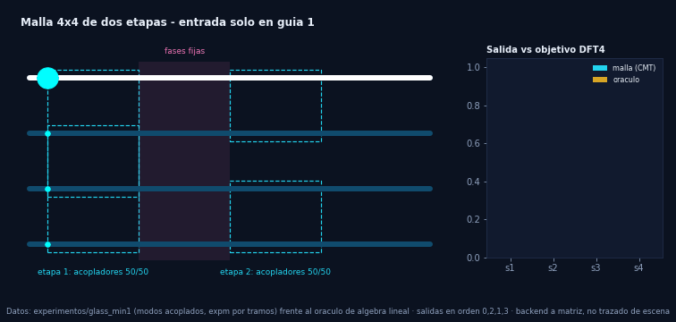

Two stages of 50/50 couplers with fixed phases perform a 4-point DFT. The oracle is pure linear algebra; the simulator integrates coupled modes piecewise. **Matrix backend**, labelled as such: it is not a trace of the scene.

### 5 · The mean misleads: what matters is 95 % of the parts

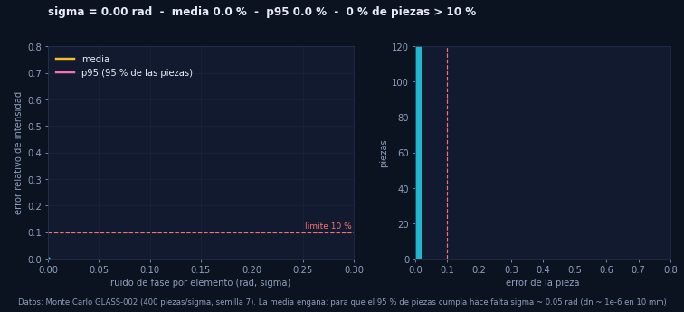

With phase noise σ = 0.10 rad the *mean* error is about 11 %, but more than half of the parts exceed 10 %. For 95 % of parts to comply, σ ≈ 0.05 rad is needed, i.e. δn ≈ 10⁻⁶ over 10 mm. That is why a coherent design needs **post-write trimming or heaters**, and why FEMTO-1 is incoherent.

### 6 · Fewer tracks, more leakage (and gaps hurt)

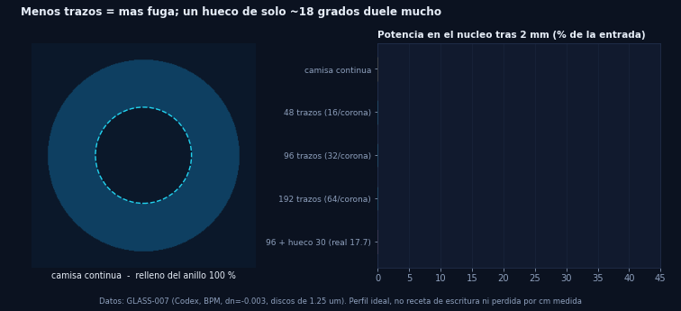

96 tracks approach the continuous cladding (33 % vs 35 % in GLASS-007; with the corrected observable and index, GLASS-009d, 33.2 % vs 36.3 %, about 8 % less). 48 tracks lose more than half. A nominal 30° gap actually opens 17.7° and sinks the power. Data from the GLASS-007 BPM.

### 7 · Two independent solvers

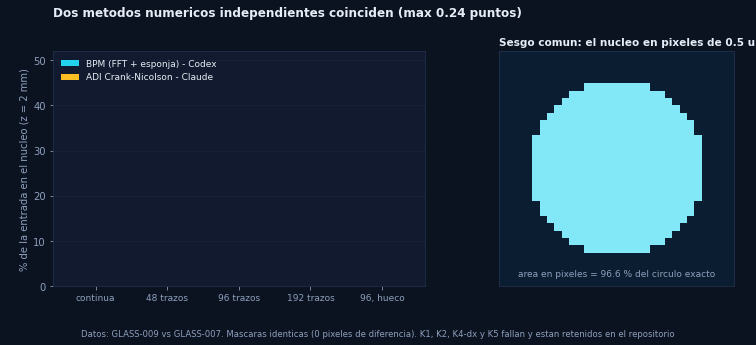

An FFT BPM and an ADI Crank–Nicolson finite-difference solver agree within ≤ 0.24 points on five profiles with identical masks. **However**, they share an observable bias (the core on 0.5 µm pixels covers 96.6 % of the exact area), and several method controls **fail**. Those failures are retained.

### 8 · Method: contract, execution, audit, retained failures

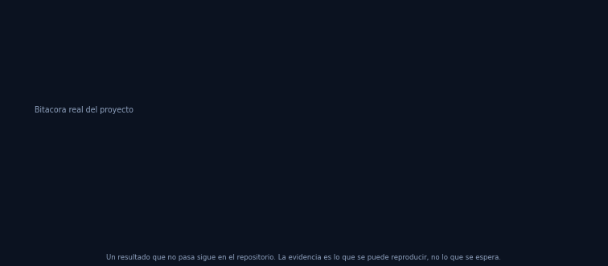

Every trial is frozen **before** measuring. Failures are neither hidden nor relaxed: they are published together with their cause.

## Results to date

Current status: [ESTADO-ACTUAL](Docs/ESTADO-ACTUAL.md). The [current inventory](Docs/PROJECT-STATUS.md) separates execution, approved criteria, failures and limits. Earlier reports and GIFs keep their dates and versions; they are not reinterpreted as device measurements.

| Milestone | Documented result | Status and limit |
|---|---|---|
| CPU environment | Isolated install, six pinned versions, 51 tests run | PASS on Windows 10 / Python 3.13.7; [report](Docs/POINT-01-RESULTS.md) |
| GLASS-001/002 | Feasibility and ideal DFT4 intensity implementation | CMT model; output phases and mean/p95 difference explicit |
| GLASS-003 V1/V2 | Balance and scalar propagation; V2 has 15 cases | Original failures kept; −0.005 fails domain and dz |
| GLASS-004 | CMT versus analytic couplers | Nominal/controls PASS; field error ≈ 2e-16; hypothetical noise |
| GLASS-005 | Radial m = 0 reference and longitudinal-step diagnosis | Selected cases; SK1310 recipe and measurements pending |
| GLASS-006a | 20 geometries, 18 selected modes | G2: 7 PASS / 11 FAIL; two cases without a selected mode |
| GLASS-006b | Coupler pilot run: 12 CPU cases | Linearity/symmetry and partial controls PASS; dx and Gaussian reduction FAIL |
| GLASS-007 V1/V2 | Discrete tracks; V2 with coverage and partial detector | V2: 13 cases and own criteria PASS; boundary/global pending |
| GLASS-008/009 | Geometry and a second ADI propagator | Partial agreement; historical K1/K2/K4-dx/K5 kept |
| GLASS-009b/d | Observable correction and coverage profile | P3 of 009b and Q4 of 96 tracks of 009d still FAIL |
| GLASS-009c | Run: complex field in vacuum, including phase | Partial validation by angle, domain and distance; isolated reflection pending |
| GLASS-010 | Six cases and 24 M4 comparisons approved | Does not resolve the whole 006a sweep; mode/remainder interference needs correction |
| GLASS-GPU-001 | Eight CUDA outputs compared with CPU | Four complex128 PASS and four complex64 FAIL |
| GLASS-GPU-001 timing | CPU median 2.4528 s / resident CUDA128 median 0.10982 s = **22.33×** | Measured digital-simulation acceleration for one hot scalar propagation case; three repetitions, not full-network inference or an energy measurement. [Original report](Docs/GLASS-GPU-2026-10-05-RESULTS.md) |
| GLASS-GPU-002 | Eight additional complex128 cases | Local criteria PASS; no global convergence or independent ADI contrast |
| MEGA-001 | 24 affine hits and four analytic CPU criteria | Diagnostic PASS; Vulkan metadata is not RT execution |

Details in [`Docs/`](Docs/), [`coordinacion/respuestas/`](coordinacion/respuestas/) and [`resultados/`](resultados/).

The [independent V2 replication](Docs/GLASS-007-V2-RESULTS.md) confirms that 96 tracks retain 8.5 % less power in the core than the continuous cladding. The same replication separates the effect of averaging the index from that of the detector. The earlier GIFs keep V1 data; they are not V2 figures. Boundary, global convergence and fabrication have not been certified. Both of our own writing failures are kept alongside the hash-based continuation, without repeating four valid cases.

### What the repository does **not** demonstrate

- No real waveguide. The profiles are ideal: scalar, paraxial, without polarization, reflection, bends, roughness or stress.
- No measured loss per cm. The continuous ring is a model reference, not a universal bound.
- No fabricated neural network. A passive mesh is **linear in field**; nonlinearity, detection and electronics sit outside the cube and must be declared separately. FEMTO-1 is a plan, not a device.
- No measured speed or efficiency advantage over other networks. The GPU comparison in the [FEMTO-1 section](#femto1) is a parametric model.

## Repository structure

```
Silice-Neuro3D-Cube/
├── src/silice/        library (7 modules): bpm.py (scalar paraxial BPM), tracks.py (discrete
│                      tracks), coupler.py (CMT coupling), coverage.py (partial area and
│                      coverage), gpu_bpm.py and gpu_refinement.py (bounded CUDA trials)     [Codex]
├── tests/             CPU tests                                                            [Codex]
├── scripts/           trials, audits, verification (check.py)                              [Codex]
├── experimentos/      Claude's milestone trials (glass_*, t2x_*, neurocubo_blender_claude)  [Claude]
├── agentkit/          closure kit: preregistration, statistics, limits, metrology (61 tests)
├── tools/             generators of the README GIFs from the data
├── assets/            README GIFs and header
├── resultados/        JSON reports with parameters, hashes and criteria (retained evidence)
├── paper/             manuscript and full paper for review
├── Docs/              contracts, results, reviews, status and closure reports
├── coordinacion/      checkpoint, board, queue, responses and agent tasks
├── .github/           CI: CPU tests on Windows and Linux, blob-size guard
├── requirements/      hash-pinned dependency locks
├── pyproject.toml     silice-neuro3d-cube package metadata
└── AGENTS.md          collaboration and review rules between agents
```

## Reproduce

The reproducible CPU install uses Windows 10 x64 and CPython 3.13.7. A validated Linux path (Ubuntu 24.04, CI on GitHub Actions) is described in [CPU-REPRODUCTION](Docs/CPU-REPRODUCTION.md#linux-ci-validated-path). From the repository root:

```powershell
& 'C:\Python313\python.exe' scripts/bootstrap_cpu.py
```

The command installs six dependencies with pinned versions and hashes into `.venv`, installs the package and runs the full environment check. Instructions and an offline option are in [CPU-REPRODUCTION](Docs/CPU-REPRODUCTION.md).

To repeat the check without reinstalling, or to run only the 51 current CPU tests:

```powershell
& '.\.venv\Scripts\python.exe' scripts/verify_environment.py
& '.\.venv\Scripts\python.exe' -B scripts/check.py
```

The check produces fresh reports, verifies the hashes of the historical evidence and limits each numerical process to one thread and 40 seconds. It includes the tests, the CMT audit, the GLASS-007 V2 audit and the 15 GLASS-003 V2 cases. The scientific convergence failure of GLASS-003 V2 must be reproduced with complete results and correct balances; it does not become an approved convergence. Each trial's historical instructions keep their own scope and limits. This install does not run the GPU or Blender.

## Method and collaboration

Read the [research contract](Docs/RESEARCH-CONTRACT.md), the [checkpoint](coordinacion/CHECKPOINT.md) and the [board](coordinacion/TABLON.md). Codex and Claude have independent tasks and review each other's evidence. **JEV does not count as consulted without `provenance=jev`.** The earlier `9_NEBULA_NEW` project is left intact.

Rules:

- Contract before measuring.
- Thresholds are never relaxed afterwards.
- Failures are retained.
- Visualization, mathematical model, simulation and physical device are always kept distinct.
- No GPU or Blender load without a window and an exclusive reservation.
- No contact, purchase or data agreement with any laboratory or foundry without the owner's explicit approval.

Authorship, roles and use of AI: [CONTRIBUTORS.md](CONTRIBUTORS.md). How to cite the repository: [CITATION.cff](CITATION.cff).

## Roadmap

Status as of 13 October 2026. Detail and evidence for each item: [claims ledger](Docs/CIERRE-20261012/CLAIMS-TABLE-20261013b.md) and [`Docs/CIERRE-20261012/`](Docs/CIERRE-20261012/).

**Done (closure guide v2)**

- [x] Closure kit [`agentkit/`](agentkit/), identical to the guide, with 61 tests on Windows and Linux (CI)
- [x] Preregistered kill tests: 3D vs planar depth and crossings (T25), in-situ calibration in a model (T27), energy per operation (T24, **negative result**) and state of the art with 31 verified references (T26)
- [x] Trench-guide design (T20D) and H1 amendment A1, dated before measuring
- [x] Adversarial review (T30) and corrected central claim (delimitation, not novelty)
- [x] Ledger of 41 claims, short manuscript and [full paper for review](paper/full/paper.pdf)
- [x] [Apache-2.0](LICENSE) license
- [x] [Fabrication dossier](Docs/CIERRE-20261012/T28-FABRICATION-DOSSIER.md) and [candidate laboratories](Docs/CIERRE-20261012/LAB-PARTNERS-20261013.md)
- [x] **F1 recovered (F1R2):** registered repeat of the D16 temporal convergence (h = 0.35 µm) on local CPU. It meets all five contract criteria (field difference 1.35·10⁻⁵ ≤ 10⁻⁴) and the audit; [report](Docs/CIERRE-20261012/T01-F1R2-RESULTS.md). The Colab results were lost and the first attempt (F1R) failed for memory; both are documented.

**Next: FEMTO-1 prototype** ([plan](#femto1))

- [ ] F0 Foundry rules and file format (owner)
- [ ] F1 MNIST 4×4 data, sealed split and preregistration
- [ ] F2 Hardware-aware training with 8-parameter readout calibration
- [ ] F3 Compiler from weights to crossing-free 3D geometry, with design-rule check
- [ ] F4 Blender digital twin and sealed benchmark inside Blender
- [ ] F5 Independent beam-propagation physics (coupler, tree, spectrum, polarization, modes)
- [ ] F6 Fabrication Monte Carlo, optical budget and adversarial review
- [ ] F7 Multi-format fabrication package (JSON, CSV, STEP, DXF, STL, PDF)
- [ ] F8 Freeze, independent rerun and owner approval to send
- [ ] F9 Bench characterization after fabrication (C1–C4)

**Pending: numerical work**

- [ ] T01: S16 spatial convergence and reserved 0.28 µm mesh (after F1R2)
- [ ] T03: joint boundary, field and phase in guides
- [ ] T04: biorthogonal decomposition with the leaky modes of GLASS-010
- [ ] T06: independent vectorial contrast (Nédélec FEM or shooting method)
- [ ] T07: coupler with modal ports (GLASS-006b)
- [ ] T12 and T16: network with gain-matched references and a reserved test
- [ ] H-C: calibration with N = 16 and 32 and a noisy intensity-only loop

**Pending: laboratory (needs a partner)**

- [ ] Blind cut-back at 1550 nm of 12 and 16 µm trench guides (H1-A ≤ 0.3 dB/cm; H1-SOTA ≤ 0.06 dB/cm)
- [ ] Per-stage loss of a written MZI mesh, which decides part (b) of the central claim, and series crossings and 3D transitions, which decide part (c)
- [ ] Measured index profile (T05) and face-to-face registration (T09)

**Pending: external**

- [ ] External human review of the paper, independent reproduction (T21) and DOI archive

<details>
<summary>Earlier roadmap (10 October 2026, kept)</summary>

- [x] Scalar paraxial BPM + second radial solver + independent 2D solver
- [x] Continuous and discrete-track cladding (ideal model)
- [x] Observable with partial area and coverage profile (009b/d, GLASS-007 V2 replication)
- [ ] Complete boundary and phase in guides: 009c run with partial validation in vacuum
- [ ] Measured SK1310 profiles/tracks (needs the full PDF) and real modes
- [ ] Close the coupler: GLASS-006b pilot run; modal basis and independent contrast pending
- [ ] Bends, face-to-face registration, correlated tolerances and calibration
- [ ] Small 3D network with a frozen task, separating detection and nonlinearity
- [ ] Fabrication: outside the scope at the time (now planned as FEMTO-1)

</details>

Remote repository: [`Agnuxo1/Silice-Neuro3D-Cube`](https://github.com/Agnuxo1/Silice-Neuro3D-Cube) (public; reviewed results are published on **main**). License: **Apache-2.0** ([LICENSE](LICENSE), [NOTICE](NOTICE)).
